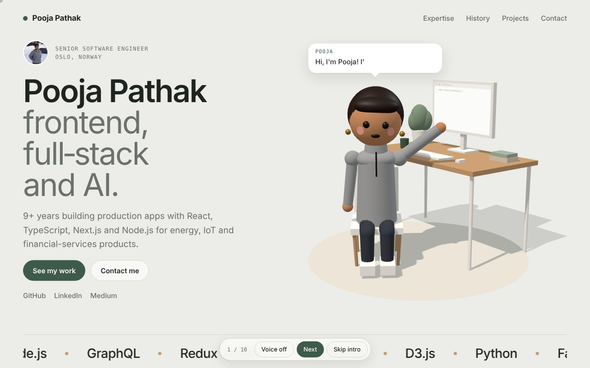
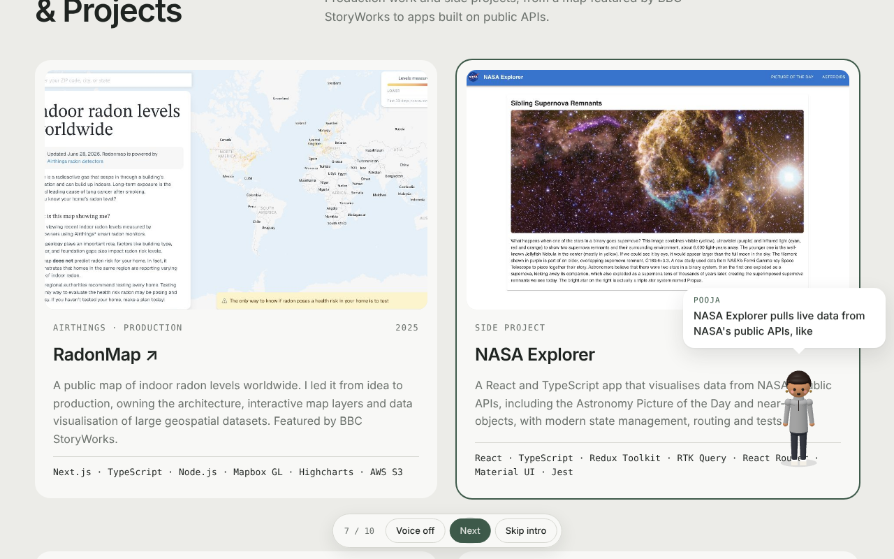

# Pooja Pathak · 3D Portfolio

An interactive 3D portfolio built with **React, React Three Fiber and GSAP**. When the page loads, my avatar is typing at her desk. She turns around, says hi, then stands up and walks visitors through my expertise, work history and projects, explaining each one in a speech bubble (with optional voice).





## Tech stack

| Area | Tools |
| --- | --- |
| UI | React 18, TypeScript (strict), Vite |
| 3D | three.js, React Three Fiber |
| Animation | GSAP, @gsap/react, ScrollTrigger, ScrollToPlugin |
| Browser APIs | Web Speech API, IntersectionObserver, ResizeObserver, Canvas 2D |
| CI | GitHub Actions (typecheck + production build) |

## How it works

- **Two R3F canvases.** `DeskScene` renders the hero room with soft shadows. `WalkerOverlay` is a transparent full-screen canvas with an orthographic camera where one world unit equals one CSS pixel, so the avatar can stand exactly next to any DOM element.
- **A frame-loop store, not React state.** The tour lives in a small mutable store (`src/tour/store.ts`). Both scenes read it inside `useFrame` without causing re-renders; React UI subscribes to the few values it shows through `useSyncExternalStore`.
- **A step machine.** `TourDirector` runs walk → talk → hold → next for each step in `src/data/tour.ts`, waiting on the 3D scenes (avatar facing the camera, avatar arrived) before speaking.
- **Procedural avatar.** `src/three/rig.ts` builds her from primitives and animates sitting, typing, walking, waving and talking in code. A rigged `.glb` can replace the body at runtime.
- **The monitor** is a Canvas 2D code editor drawn into a texture that types along with her.

## Performance

- three.js is code-split and loaded lazily after the page content renders; GLTFLoader only downloads if a custom avatar is used
- Shared geometries and materials, static scenery with frozen matrices, no per-frame allocations
- Rendering pauses when the hero is off screen and the overlay only renders during the tour
- Pixel ratio capped (1.75 hero, 1.5 overlay); speech bubble moves with `transform` only
- Respects `prefers-reduced-motion` everywhere (no walking, typing or GSAP motion)

## Getting started

```bash
npm install
npm run dev        # http://localhost:5173
npm run build      # typecheck + production build into dist/
npm run preview    # serve the production build
```

Requires Node.js 18 or newer.

## Project structure

```
src/
├── data/
│   ├── content.ts      # profile, expertise, history, projects, links  ← edit your content here
│   └── tour.ts         # what the avatar says and where she walks      ← edit the tour here
├── components/         # Header, Hero, Marquee, Expertise, History, Projects, Contact, Footer, Cursor
├── three/
│   ├── DeskScene.tsx   # hero room: desk, chair, monitor, lights, seated avatar
│   ├── WalkerOverlay.tsx
│   ├── rig.ts          # procedural avatar + custom .glb support
│   ├── codeScreen.ts   # the typing code editor on the monitor
│   └── loadAvatar.ts   # lazy GLTFLoader for custom avatars
├── tour/               # store, director, speech bubble, tour bar, voice
├── lib/                # motion helpers, GSAP scroll, scroll reveal hook
└── styles.css
public/
├── img/                # project screenshots and profile photo
└── models/             # put your avatar .glb here
```

## Customize

- **Content:** everything on the page comes from `src/data/content.ts`.
- **Tour:** `src/data/tour.ts`. Each step has `el` (a CSS selector to stand by), `ax`/`ay` (a point on that element, 0 to 1) and `text`.
- **Contact form:** copy `.env.example` to `.env` and set `VITE_FORM_ENDPOINT` (Formspree, Web3Forms or your own API). Set the same variable in Vercel.
- **New project:** add an entry to `projects` in `content.ts`, a screenshot in `public/img/`, and a step in `TOUR`.

## Make the avatar look like you

1. Give an AI image tool a full-body photo plus a prompt like *"3D Pixar-style character of this person, full body, front, side and back views, T-pose, white background"*.
2. Turn the views into a 3D model with an image-to-3D tool (Meshy, Tripo or Hunyuan3D) and download a `.glb`.
3. Rig it on [Mixamo](https://www.mixamo.com) and download: idle, walking, waving, talking, sitting typing.
4. In Blender, combine the clips, rename the actions `idle`, `walk`, `wave`, `talk`, `sit_typing`, and export as glTF Binary.
5. Save as `public/models/pooja.glb` and set `AVATAR_URL` in `src/data/tour.ts`.

Test a file first with the **Load your avatar** button in the footer, then remove that button.

## Deploy

**Vercel (recommended):** import the repo at [vercel.com/new](https://vercel.com/new). Vite is detected automatically (build `npm run build`, output `dist`).

**GitHub Pages:** the build uses relative paths (`base: './'`), so `dist/` works from any sub-path.

## Contact

**Pooja Pathak** · Senior Software Engineer, Oslo
[LinkedIn](https://www.linkedin.com/in/pooja-p-09774b79) · [GitHub](https://github.com/poojavirgo) · [Medium](https://medium.com/@poojapathak)
